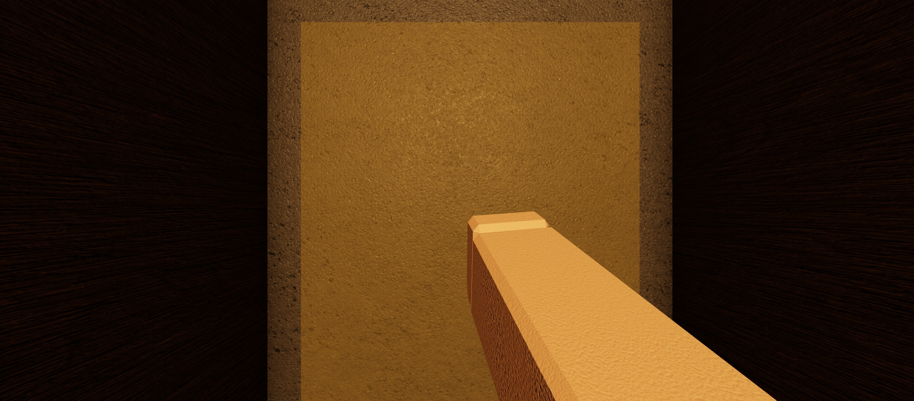
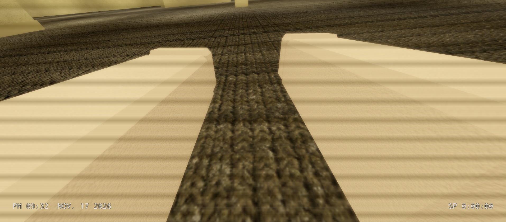
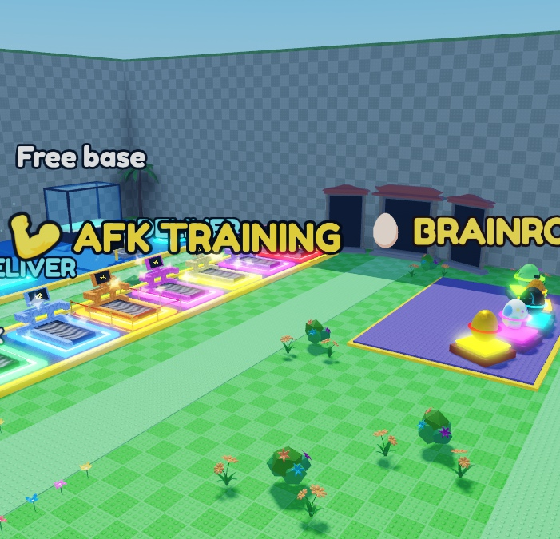
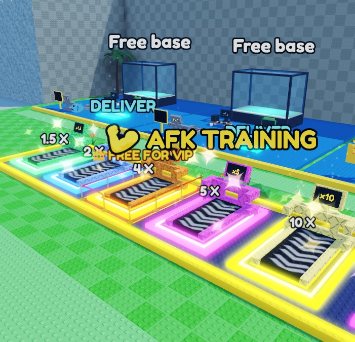
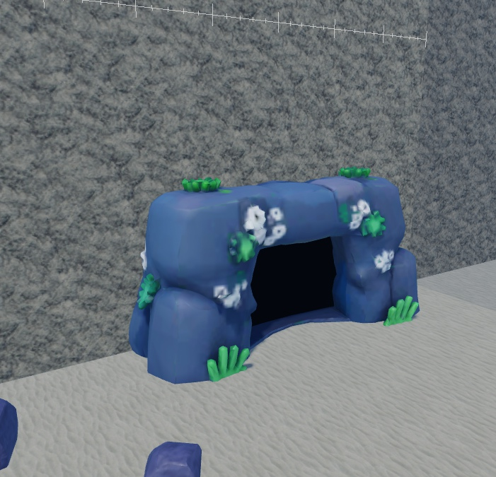

# Roblox scripting samples (Luau)

Code samples from my Roblox work. Every script here was written for a real project and runs in Studio as-is (they depend on each project's own `Config` module, which is not included).

## 1. Noclip into the Backrooms: first-person cinematic

🎥 Video: https://medal.tv/games/imported-clips/clips/nXuDem9gl2ewYyGQO

A ~10 s first-person sequence: the player's hand goes through a wall, the screen fades to black, they fall, hit the Level 0 carpet and stand up, with a VHS overlay at the end. Everything is procedural: scripted camera, viewmodel arms cloned from the player's own avatar, post-processing, ScreenGui effects and sound. No animation assets.

| File | What it does |
|---|---|
| [`noclip-cinematic/src/shared/NoclipConfig.luau`](noclip-cinematic/src/shared/NoclipConfig.luau) | Every timing, intensity and audio ID in one place |
| [`noclip-cinematic/src/server/NoclipServer.server.luau`](noclip-cinematic/src/server/NoclipServer.server.luau) | Trigger detection (CollectionService tag), cooldown, freezes and teleports the character during the blackout |
| [`noclip-cinematic/src/client/NoclipClient.client.luau`](noclip-cinematic/src/client/NoclipClient.client.luau) | Phased camera timeline, viewmodel arms, raycast to the wall, effects, VHS |

Full write-up: [`noclip-cinematic/README.md`](noclip-cinematic/README.md)

## 2. STEAL A FISH (tycoon, ~19k lines of Luau)

Two server modules from my tycoon game:

| File | What it does |
|---|---|
| [`steal-a-fish/DataStore.luau`](steal-a-fish/DataStore.luau) | Player data with **session locking** (two servers never overwrite the same profile), `UpdateAsync`, retries with exponential backoff, and a safety rule: if loading fails, the profile is never saved over good data |
| [`steal-a-fish/PetService.luau`](steal-a-fish/PetService.luau) | Weighted egg rolls, equipped-pet multipliers, and pets that follow the player with `AlignPosition`/`AlignOrientation`, network-owned by their owner, spaced on a half circle that adapts to the character's size |

